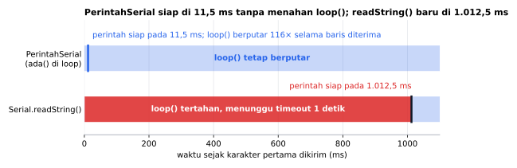

# PerintahSerial

[English](README.en.md)

Library Arduino berbahasa Indonesia untuk **membaca perintah teks** dari Serial Monitor, Bluetooth HC-05, SoftwareSerial, atau Stream apa pun. Non-blocking, tanpa callback, tanpa `String`.

```cpp
if (perintah.ada()) {
  if (perintah.adalah("LED") && perintah.adalah("ON", 1)) ...
  if (perintah.adalah("SET")) kp = perintah.desimal(2);
}
```

## Fitur

- **Non-blocking**: `ada()` hanya membaca data yang sudah tiba, tidak pernah menunggu. `loop()` tetap jalan.
- **Tanpa callback**: cukup `if (perintah.adalah("LED"))` di `loop()`, seperti membaca tombol.
- **Semua akhiran baris**: CR, LF, atau CRLF. Pilihan apa pun di Serial Monitor (selain "No line ending") dan aplikasi Bluetooth di HP langsung bekerja. Baris kosong diabaikan.
- **Huruf besar/kecil sama saja**: `led on` = `LED ON` = `Led On`.
- **Pemisah fleksibel**: spasi, tab, koma, dan `=`. `SET kp 2.5`, `SET kp=2.5`, dan `M 100,200` semuanya bisa. Spasi ganda tidak masalah.
- **Angka dengan pengecekan**: `angka(i, bawaan)` dan `desimal(i, bawaan)` mengembalikan nilai bawaan jika argumen tidak ada atau bukan angka (`12abc` ditolak).
- **Aman terhadap baris kepanjangan**: dibuang utuh sampai akhir baris, dilaporkan lewat `terlaluPanjang()`. Potongannya tidak pernah dijalankan sebagai perintah.
- **Hemat RAM**: buffer tetap 64 byte (bisa diatur), tanpa `String` dan tanpa alokasi dinamis. 71 byte per objek di Uno.
- **Nama perintah di flash**: `adalah(F("BANTUAN"))` agar daftar perintah tidak menghabiskan RAM Uno.

## Board yang didukung

| Board | Teruji compile |
|---|---|
| Arduino Uno / Nano | ✅ |
| Arduino Mega | ✅ |
| ESP32 DevKit | ✅ |
| ESP32-C3 / S3 | ✅ |
| STM32 Blackpill F411 | ✅ |
| STM32 Bluepill F103 | ✅ |

STM32 memakai core resmi **STM32duino** (STMicroelectronics). Library ini hanya memakai `Stream`, jadi seharusnya bekerja di board Arduino lain juga.

## Instalasi

**Library Manager:** Arduino IDE → *Sketch → Include Library → Manage Libraries…* → cari **PerintahSerial** → *Install*.

**Manual:** unduh ZIP dari GitHub → *Sketch → Include Library → Add .ZIP Library…*

## Contoh cepat

```cpp
#include <PerintahSerial.h>

PerintahSerial perintah(Serial);

void setup() {
  Serial.begin(115200);
  pinMode(LED_BUILTIN, OUTPUT);
}

void loop() {
  if (perintah.ada()) {
    if (perintah.adalah("LED") && perintah.adalah("ON", 1)) {
      digitalWrite(LED_BUILTIN, HIGH);
    } else if (perintah.adalah("LED") && perintah.adalah("OFF", 1)) {
      digitalWrite(LED_BUILTIN, LOW);
    } else {
      Serial.println("Perintah: LED ON / LED OFF");
    }
  }
}
```

Ketik `LED ON` di Serial Monitor lalu tekan Enter. Panggil `ada()` di setiap `loop()` dan hindari `delay()` panjang.

## Hasil simulasi

<!-- simulasi:awal -->

**Sesi Serial Monitor**, dijalankan di PC dengan `Stream` tiruan dan kode library ini (`extras/simulasi`). Setiap baris tabel adalah satu baris yang dikirim; kolom lainnya adalah apa yang dibaca library. `angka(i)` bernilai `bawaan` jika argumen bukan bilangan bulat.

| Diketik | Keterangan | `ada()` | `adalah("LED")` | Perintah `teks(0)` | Argumen `teks(i)` | `angka(i)` | `desimal(i, NAN)` | `terlaluPanjang()` |
|---|---|---|---|---|---|---|---|---|
| `LED ON\n` | akhiran LF | true | true | `LED` | `ON` | bawaan | NAN | false |
| `led On\r` | akhiran CR, huruf campur | true | true | `led` | `On` | bawaan | NAN | false |
| `Led oN\r\n` | akhiran CRLF | true | true | `Led` | `oN` | bawaan | NAN | false |
| `SET  kp   2.5\n` | spasi ganda | true | false | `SET` | `kp`, `2.5` | bawaan, bawaan | NAN, 2.5 | false |
| `SET kp=2.5\r\n` | pemisah = | true | false | `SET` | `kp`, `2.5` | bawaan, bawaan | NAN, 2.5 | false |
| `M 100,-200\n` | pemisah koma, negatif | true | false | `M` | `100`, `-200` | 100, -200 | 100, -200 | false |
| `SET kp 2,5\n` | desimal ditulis dengan koma | true | false | `SET` | `kp`, `2`, `5` | bawaan, 2, 5 | NAN, 2, 5 | false |
| `KEDIP 12abc\n` | bukan angka | true | false | `KEDIP` | `12abc` | bawaan | NAN | false |
| `\r\n` | baris kosong | false |  |  |  |  |  | false |
| `AAAA...A (70) \n` | 70 karakter, buffer 64 | false |  |  |  |  |  | true |
| `LED OFF\n` | baris berikutnya | true | true | `LED` | `OFF` | bawaan | NAN | false |



Simulasi: baris `SET kp 2.5\r\n` datang per karakter pada 9600 baud (1,04 ms per karakter), dengan anggapan isi `loop()` lainnya butuh 0,1 ms per putaran. Dengan `ada()`, perintah siap pada 11,5 ms dan `loop()` sempat berputar 116 kali. `Serial.readString()` baru kembali setelah timeout bawaan Stream 1000 ms, yaitu pada 1.012,5 ms, dan selama itu `loop()` tertahan (dihitung dari Stream.cpp ArduinoCore-avr 1.8.8, bukan diukur).

Tabel dan grafik dibuat dari simulasi di PC yang menjalankan kode library ini (`extras/simulasi`):

```sh
cd extras/simulasi
python gambar.py   # butuh g++ dan matplotlib
```

<!-- simulasi:akhir -->

## Kecepatan & memori

Diukur dengan simavr (simulator ATmega328P yang akurat per siklus) di Arduino Uno 16 MHz. Lima perintah (`LED`, `MOTOR`, `SET`, `GET`, `HELP`), baris `SET KP 2.5` dibaca dari `Stream` di memori dengan akhiran baris yang dibutuhkan tiap library, lalu `2.5` diubah menjadi `float`. Sketch yang sama untuk semua library.

| | PerintahSerial 1.0.1 | PerintahSerial 1.0.0 | SerialCommands 2.2.0 | SerialCmd 1.1.6 |
|---|---|---|---|---|
| Tanpa data (setiap `loop()`) | 103 siklus (6 µs) | 103 | 79 | 92 |
| Satu baris `SET KP 2.5` | 3.217 (201 µs) | 4.009 (251 µs) | 3.500 (219 µs) | 3.071 (192 µs) |
| RAM (objek + buffer + daftar perintah) | 71 B | 71 B | 126 B | 134 B |
| Flash sketch yang sama | 5.642 B | 5.714 B | 6.058 B | 5.938 B |

`ada()` O(k) untuk k karakter yang baru masuk (setiap karakter dibaca sekali). `adalah()`, `teks()`, `angka()`, `desimal()` O(panjang baris), karena kata ke-i dicari dari awal baris; dengan baris ≤ 63 karakter ini lebih murah daripada menyimpan posisi tiap kata di RAM. Memori tetap, O(ukuran buffer).

Optimasi di 1.0.1 (perilaku sama, 63 kasus uji lolos):
- `ada()` membaca dengan `read()` saja (−1 berarti kosong), satu panggilan virtual per karakter, bukan dua (`available()` lalu `read()`).
- Pencarian kata memeriksa setiap karakter sekali, bukan dua kali.
- Perbandingan huruf besar/kecil tanpa `tolower()` (panggilan fungsi pustaka di AVR).

Di mana kita kalah: SerialCmd ±150 siklus lebih cepat per baris karena membandingkan perintah apa adanya (huruf besar/kecil dibedakan, "led" tidak sama dengan "LED") dan memotong kata sekali lalu memanggil callback. SerialCommands ±25 siklus lebih cepat saat tidak ada data. Selisih itu di bawah 10 µs per baris.

Mengulang pengukuran: sketch `extras/benchmark/PerintahSerialBenchmark` (butuh simavr).

## Kata dan argumen

Baris dipecah menjadi kata. Kata ke-0 adalah perintah, kata ke-1 dan seterusnya argumen:

```
SET   kp   2.5
 0    1    2
```

| Pemanggilan | Hasil |
|---|---|
| `adalah("set")` | `true` |
| `adalah("KP", 1)` | `true` |
| `jumlahArgumen()` | `2` |
| `teks(1)` | `"kp"` |
| `desimal(2)` | `2.5` |
| `angka(2, -1)` | `-1` (2.5 bukan bilangan bulat) |
| `teks(3)` | `""` (tidak ada) |

Desimal ditulis dengan **titik** (`2.5`). Koma adalah pemisah, jadi `2,5` terbaca sebagai dua argumen: `2` dan `5`.

## Sumber selain Serial

Apa pun yang turunan `Stream` bisa dipakai: `Serial1`, `Serial2`, `SoftwareSerial`, `BluetoothSerial` (ESP32), atau koneksi TCP.

```cpp
SoftwareSerial bluetooth(10, 11);   // HC-05 di Uno
PerintahSerial perintah(bluetooth);
```

## Referensi fungsi

### Dasar

| Fungsi | Keterangan |
|---|---|
| `PerintahSerial perintah(Stream &stream)` | Buffer 64 byte, baris sampai 63 karakter. |
| `PerintahSerialUkuran<N> perintah(Stream &stream)` | Buffer `N` byte (2–255), baris sampai `N - 1` karakter. |
| `bool ada()` | Panggil di setiap `loop()`. `true` jika ada satu baris perintah baru. Baris itu berlaku sampai `ada()` dipanggil lagi. |
| `bool terlaluPanjang()` | `true` sekali setelah baris yang lebih panjang dari buffer selesai dibuang. |

### Membaca perintah

Indeks `i`: 0 = perintah, 1 dan seterusnya = argumen.

| Fungsi | Keterangan |
|---|---|
| `bool adalah(const char *kata, uint8_t i = 0)` | `true` jika kata ke-`i` sama dengan `kata` (huruf besar/kecil diabaikan). Juga menerima `F("...")`. |
| `uint8_t jumlahArgumen()` | Jumlah kata setelah perintah. |
| `const char *teks(uint8_t i)` | Kata ke-`i`, atau `""` jika tidak ada. |
| `long angka(uint8_t i, long bawaan = 0)` | Argumen ke-`i` sebagai bilangan bulat, atau `bawaan` jika tidak ada / bukan angka. |
| `bool adaAngka(uint8_t i)` | `true` jika argumen ke-`i` bilangan bulat yang valid. |
| `float desimal(uint8_t i, float bawaan = 0)` | Argumen ke-`i` sebagai desimal, atau `bawaan` jika tidak valid. Pakai `NAN` sebagai bawaan untuk mendeteksi input salah (`isnan()`). |
| `const char *baris()` | Seluruh baris apa adanya. Jika `teks()` sudah dipanggil, tab, koma, dan `=` di dalamnya menjadi spasi. |

## Contoh yang tersedia

*File → Examples → PerintahSerial*

| Contoh | Isi |
|---|---|
| `KontrolLED` | `LED ON`, `LED OFF`, `KEDIP 200`. |
| `AturNilaiLewatSerial` | Tuning PID tanpa upload ulang: `SET kp 2.5`, `LIHAT`. |
| `RobotBluetooth` | Robot dari HP lewat HC-05 (SoftwareSerial di Uno, Serial1 di Mega, ESP32, dan STM32). |
| `DaftarPerintah` | Menu `BANTUAN`, nama perintah dengan `F()`. |

## Dibanding library lain

Dibaca dari source code library populer di Library Manager (Oktober 2026):

| Library | Temuan |
|---|---|
| SerialCommands 2.2.0 | Akhiran bawaan `"\r\n"`, jadi perintah tidak pernah dijalankan jika Serial Monitor diatur "New Line" (hanya LF). Perbandingan perintah membedakan huruf besar/kecil. Saat buffer penuh, buffer dikosongkan lalu sisa baris diproses sebagai perintah baru. |
| SerialCmd 1.1.6 | Akhiran bawaan hanya CR, pemisah bawaan koma. Ukuran buffer (30), panjang perintah (6), dan pilihan huruf besar diatur dengan mengedit `#define` di file library. Saat buffer penuh, sisa baris juga diproses sebagai perintah baru. |
| CmdParser 1.7.0 | `readFromSerial()` tanpa batas waktu menunggu (blocking) sampai akhiran baris tiba. |
| SimpleCLI 1.1.4 | README mencontohkan `Serial.readString()`, yang menunggu hingga 1 detik (timeout bawaan Stream). Memakai `String` dan `malloc`. |

SerialCommands dan SerialCmd juga mewajibkan satu fungsi callback per perintah. PerintahSerial memakai `if` biasa di `loop()`.

## Pengujian

Akhiran baris, data yang datang sedikit-sedikit, huruf besar/kecil, argumen negatif/desimal/bukan angka, pemisah ganda, baris kosong, dan baris kepanjangan diuji otomatis di PC (`extras/test`) setiap ada perubahan:

```sh
cd extras/test
g++ -std=c++11 -I. -I../../src uji.cpp ../../src/*.cpp -o uji && ./uji
```

## Status

Versi 1.0.1 sudah lolos uji logika otomatis dan compile di 7 board, tapi **belum diuji di hardware sungguhan**. Jika menemukan masalah, silakan buka *issue* di GitHub.

## Lisensi

MIT © 2026 Amadeo Wisesa. Lihat [LICENSE](LICENSE).
